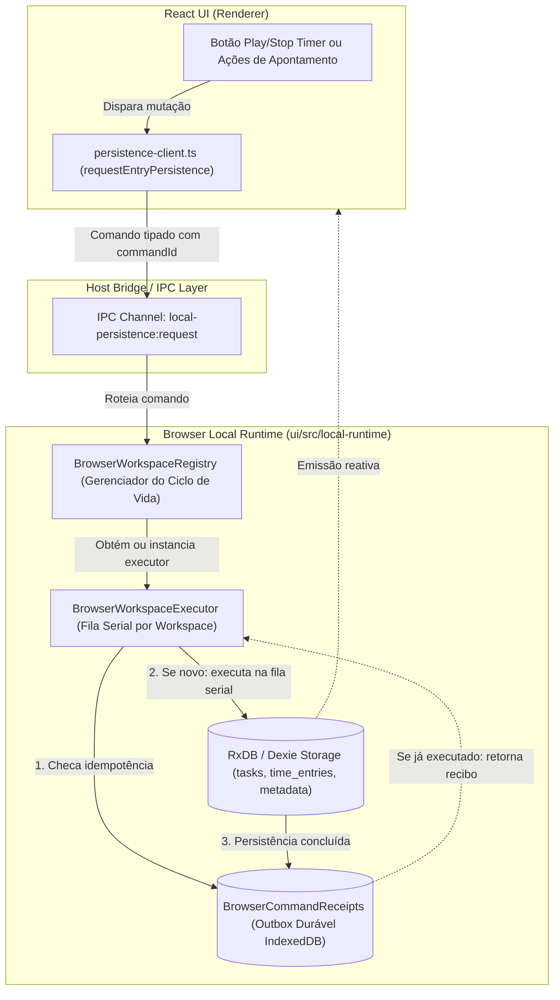

# Browser Local Runtime (`ui/src/local-runtime`)

O **Custodiante Local-First no Renderer (Chromium)** do Mr. Tick. Responsável por implementar a persistência reativa do banco de dados local (**RxDB / IndexedDB**), gerenciar a concorrência serial de escrita e garantir idempotência durável de comandos em tempo de execução no navegador.

---

## 🎯 Por que este módulo existe?

No Mr. Tick, a interface gráfica (React) roda no **Renderer Process** do Chromium, onde reside a API de armazenamento de alta performance reativa **IndexedDB**. 

Para evitar corrupção de dados, perdas silenciosas de horas de trabalho e colisões de revisão (`RxError: CONFLICT`) no IndexedDB em cenários de alta concorrência (ex: sincronização em segundo plano rodando enquanto o usuário inicia/para timers ou clica repetidamente), este módulo atua como o **executor canônico serializado** de todas as operações locais.

---

## 🏗️ Arquitetura e Fluxo de Execução

---

## 📦 Componentes e Responsabilidades

| Arquivo | Papel Arquitetural | Responsabilidade |
| :--- | :--- | :--- |
| [`browser-workspace-registry.ts`](file:///c:/myapps/metric-context/metric/src/packages/ui/src/local-runtime/browser-workspace-registry.ts) | **Factory & Lifecycle Manager** | Implementa `ILocalWorkspaceFactory`. Gerencia instâncias de executores, criação das coleções RxDB (`time_entries`, `tasks`, `metadata`), transições de status de sync e encerramento seguro. |
| [`browser-workspace-executor.ts`](file:///c:/myapps/metric-context/metric/src/packages/ui/src/local-runtime/browser-workspace-executor.ts) | **Serial Execution Engine** | Implementa `ILocalWorkspaceExecutor`. Enfileira operações assíncronas em uma fila serial determinística (`this.serial`), executando queries (`queryCore`) e comandos de persistência no RxDB. |
| [`command-receipts.ts`](file:///c:/myapps/metric-context/metric/src/packages/ui/src/local-runtime/command-receipts.ts) | **Durable Idempotency Outbox** | Mantém uma object store dedicada no IndexedDB (`mr-tick-command-receipts-${workspaceId}`) com recibos de transação para proteger contra requisições duplicadas. |
| [`persistence-client.ts`](file:///c:/myapps/metric-context/metric/src/packages/ui/src/local-runtime/persistence-client.ts) | **React UI Gateway** | Fornece `requestEntryPersistence`, a função pública utilizada por componentes React e hooks para enviar mutações sem manipular diretamente os bancos internos. |
| [`index.ts`](file:///c:/myapps/metric-context/metric/src/packages/ui/src/local-runtime/index.ts) | **Public Barrel** | Exporta as fábricas e contratos públicos consumidos pela aplicação desktop. |

---

## 🛡️ Invariantes e Garantias de Engenharia

1. **Fila Serial Estrita (`this.serial`)**:
   - Cada `BrowserWorkspaceExecutor` processa suas mutações em sequência determinística através de encadeamento de promessas (`this.tail`).
   - Nenhuma escrita concorrente atinge o RxDB em paralelo para o mesmo workspace, eliminando o erro de revisão concorrente (`409 Conflict`) característico de engines NoSQL locais.

2. **Idempotência Durável com Recibos (`CommandReceipt`)**:
   - Todo comando possui um identificador único (`commandId` UUID) e um cálculo de fingerprint do payload.
   - Antes de iniciar qualquer alteração, o executor consulta `BrowserCommandReceipts`. Se o comando já foi executado, o resultado anterior é retornado imediatamente, impedindo a criação de apontamentos de horas duplicados.

3. **Isolamento Multitenant por Workspace**:
   - Cada workspace possui seu próprio banco RxDB e sua própria store de recibos isolada.
   - A função `registerDatabaseScope` atrela instâncias do banco ao respectivo `workspaceId` via `WeakMap`, impedindo vazamento cruzado entre workspaces.

4. **Zero Acesso Direto de Escrita na UI**:
   - Nenhum componente ou hook React faz `.insert()`, `.patch()` ou `.remove()` diretamente no RxDB para mutações de apontamento.
   - Todas as alterações passam obrigatoriamente por `requestEntryPersistence`, garantindo auditoria e emissão de eventos consistentes.

---

## 🚫 O que NÃO deve ficar aqui

- **Lógica de Apresentação / JSX**: Telas, botões, modais e componentes visuais pertencem a `ui/src/components/` ou `ui/src/pages/`.
- **Regras Matemáticas Puras de Timer**: Cálculos de tempo decorrido, arredondamentos e regras de transição pertencem a `application/src/services/local-runtime/local-runtime-rules.ts`.
- **Chamadas de Rede HTTP**: Comunicação com APIs externas e conectores pertence exclusivamente aos addons e ao contexto `services/sync/`.
